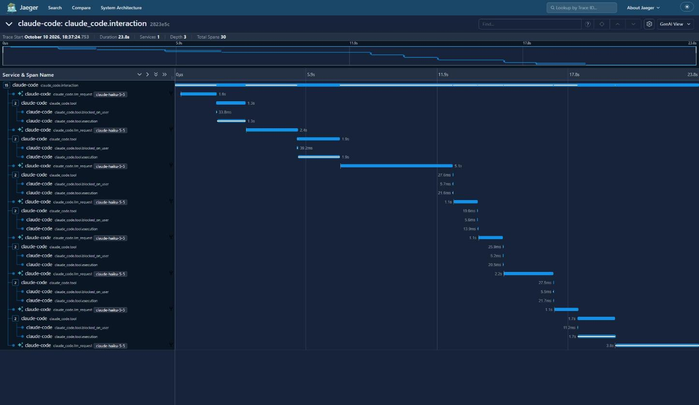
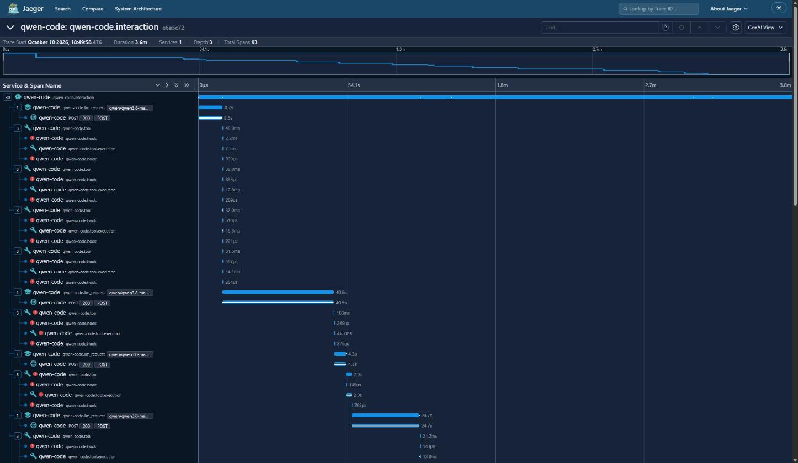
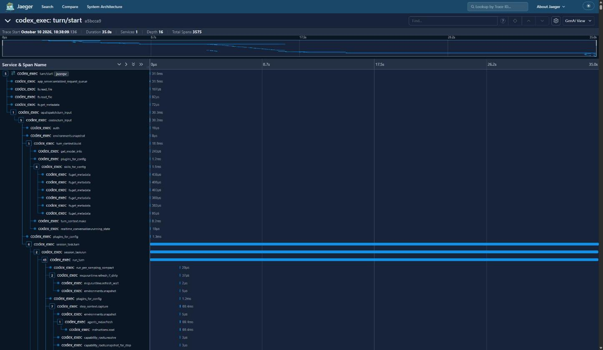

# One standard, three dialects: what Claude Code, Codex and Qwen Code send over OpenTelemetry

*Part 1 of 2. Part 2 covers what backends (Jaeger, Logfire, LangSmith, Langfuse,
Braintrust) do with this data.*

Most terminal coding agents now say they "support OpenTelemetry". I picked three that
between them cover the range: Claude Code, OpenAI's Codex CLI and Qwen Code. It's a
deliberately mixed sample, not a ranking (more on why these three below). All three
export traces, logs and metrics to any OTLP endpoint you point them at. So I pointed them
at the same local collector, gave them the same small coding task, and kept every record
they sent.

Three things stood out before I'd even opened a trace viewer:

- **Codex sent about 4,700 spans for a 35-second task.** Most of them are its internals:
  filesystem metadata reads, config loading, and a span for nearly every streamed
  response event.
- **Qwen Code's default telemetry can include what it remembers about you.** With its
  default `logPrompts=true`, its background memory extractor's reads and writes of
  `~/.qwen/memories/` end up in the exported logs, along with your prompt and the files
  it read.
- **Swapping the model changed nothing about the telemetry's structure.** Claude Code on
  Opus or on Haiku, Codex on two different GPT-6 models, Qwen Code on Flash or on Max: each
  agent sent the same span names and the same attribute keys every time.

"Supports OpenTelemetry" tells you about the transport. What gets sent is a product
decision each vendor made, and they made
three very different ones. Claude Code sends tidy product analytics. Codex sends a
profiler dump. Qwen Code follows the GenAI semantic conventions most closely of the
three, and has the loosest privacy defaults.

Everything here is reproducible. The kit (collector config, run scripts, analysis
scripts, the full findings) is at
[github.com/spenceclark/code-agent-otel](https://github.com/spenceclark/code-agent-otel).

## OpenTelemetry in 60 seconds

If you already know OTel, skip ahead.

OpenTelemetry (OTel) is a vendor-neutral standard for three kinds of telemetry:

- **Traces** are trees of **spans**. A span is a named, timed operation ("call the
  model", "run a tool") with key-value **attributes** and a parent. Viewed as a waterfall,
  a trace shows what happened, in what order, and where the time went.
- **Logs** are timestamped records. They can be a plain line of text or a structured
  event with named fields, and either kind can carry the trace and span it happened in.
  All three agents here use structured events, such as `api_request` or `tool_result`,
  each with a dozen or more attributes. The text part is usually just the event's name.
- **Metrics** are numbers aggregated over time: counters, gauges, histograms.

Programs *push* all three over **OTLP** (gRPC or HTTP), usually to a **collector**. The
collector can filter and transform the data, then forward it to one backend or several at
once:

```
             a program (here, a coding agent)
        ┌─────────────────────────────────────────┐
        │      traces      logs      metrics      │
        └────────────────────┬────────────────────┘
                             │  pushed over OTLP (gRPC or HTTP)
                             ▼
        ┌─────────────────────────────────────────┐
        │             OTel Collector              │
        │  receive → filter / transform → export  │
        └────┬───────────────┬───────────────┬────┘
             ▼               ▼               ▼
       trace viewer    metrics store   LLM platform
         (Jaeger)      (Prometheus)   (Logfire, ...)
```

The collector is optional, since a program can push straight to a backend. But it's where
you get to fan data out, or scrub it before it leaves your machine.

The standard covers the transport and the data model, but attribute names are mostly up
to you. That's where **semantic conventions** come in: names the OTel project
standardises for common things such as HTTP requests and database calls. The **GenAI
semantic conventions** do the same for LLM work, with names such as
`gen_ai.operation.name` (`chat`, `execute_tool`, `invoke_agent`), `gen_ai.request.model`,
`gen_ai.provider.name` and `gen_ai.usage.input_tokens`.

They're an official part of OTel, but every piece is still marked *Development*
(experimental), and the names are still moving: `gen_ai.system` became
`gen_ai.provider.name` in 2025, and the token-usage metrics are being reworked now.
Backends that understand these names can show you model calls, token counts and agent
runs without knowing anything about the program that sent them. That's where the three
agents part ways.

## Who supports what, and why these three

Here's where seven well-known coding agents stand. I tested the first three. The rest
come from each project's docs and source code, checked on 10 October 2026.

| Agent | Traces | Metrics | Logs | Attribute naming | Content exported by default |
|---|---|---|---|---|---|
| **Claude Code** (tested) | yes (beta flag) | yes | yes | own `claude_code.*`, a few `gen_ai.*` | prompt redacted; your email on every record |
| **Codex CLI** (tested) | opt-in; span names undocumented | yes (default exporter sends to OpenAI) | yes | `codex.*` events, internal span names, `gen_ai.usage.*` | prompt redacted; tool arguments and output, including file contents |
| **Qwen Code** (tested) | yes | yes | yes | GenAI conventions + `qwen-code.*` | prompts and file contents, in logs |
| **GitHub Copilot CLI** | yes | yes | span events only | GenAI conventions + `github.copilot.*` | off; pseudonymous user ID |
| **Gemini CLI** | yes | yes | yes | mostly `gemini_cli.*`, some `gen_ai.*` | prompts, in logs; your email when signed in |
| **OpenCode** | experimental | no | yes | Vercel AI SDK (`ai.*`, `gen_ai.*`) | prompts, once its LLM spans are switched on |
| **Cursor** (incl. CLI) | no | Enterprise only, sent from Cursor's servers | Enterprise only, sent from Cursor's servers | `cursor.*` | usage only; CLI prompt text isn't exported |

One caveat on the Gemini CLI row: Google moved its consumer and free users to
Antigravity CLI in June 2026. The repo's FINDINGS.md has a longer version covering 14
agents, with protocols, the settings that switch telemetry on, and sources.

**The naming column lines up with who writes the standard.** The GenAI conventions are
maintained by people from Google and Microsoft. The approvers listed in the repo come from
Google, Microsoft, Splunk, Honeycomb, Alibaba and Pydantic. The two agents that follow the
conventions most closely come from companies on that list:

- Copilot CLI, from GitHub (part of Microsoft);
- Qwen Code, from Alibaba.

Claude Code and Codex come from the two big labs that aren't on it, and they mostly use
their own names.

It isn't a clean rule. Google co-maintains the conventions, yet Gemini CLI mostly uses its
own `gemini_cli.*` names. And with every part of the conventions still experimental,
there's a fair argument for not building on them yet. Still, nearly every observability
backend already keys on `gen_ai.*`, so an agent that skips it is the one that loses out.

**Why these three.** I chose them for range, not size.

- **Claude Code and Codex are the two most-used terminal agents** in this year's
  developer surveys. 65.5% and 29.5% of Stack Overflow's 2026 respondents had used them
  in the past year, and JetBrains' 2026 survey found 39% and 16% using them at work. They
  also take opposite approaches to telemetry.
- **Qwen Code is much smaller.** Alibaba hasn't published usage figures, it wasn't an
  option in either survey, and it gets about 80,000 npm downloads a week against Claude
  Code's 12 million. I included it because it's open source and follows the GenAI
  conventions closely. It inherited much of that from Gemini CLI: Qwen Code was
  "originally based on Google Gemini CLI v0.8.2", and its telemetry module still carries
  Google's copyright headers. That makes it a good test of what following the
  conventions gets you.

Two others would make good additions:

- **Copilot CLI** is the convention-following agent with the big user base. Its docs
  describe an `invoke_agent` → `chat` / `execute_tool` span tree, though it exports over
  HTTP only and has no separate log signal.
- **OpenCode** is third among terminal agents in both surveys. Its OTel support is still
  experimental and mostly undocumented.

## The setup

```
claude -p ─┐
codex exec ┼─> OTLP ─> OTel Collector ─┬─> JSONL files, one per agent per signal (the raw evidence)
qwen -p ───┘                           ├─> Jaeger (traces)
                                       └─> Prometheus (metrics)
```

Everything ran locally on one Windows 11 machine. The collector (contrib 0.162.0) writes
every export request verbatim to JSONL, grouped by `service.name`, so each agent's output
can be compared record by record.

**The task.** Each agent got the same headless prompt against a tiny Python repo:

> Add a function `slugify(text)` to text_utils.py ... Add unit tests for it ... Then run
> the test suite with `python -m pytest -q` and make the whole suite pass.

The repo has one deliberately failing test (an off-by-one in an existing `truncate`
function), so "make the whole suite pass" forces a second edit and a re-run. That means
every agent has to read files, edit files, run a shell command, and loop.

**The canaries.** Two unique strings make leaks easy to spot: one appears only in the
prompt, the other only inside a source file. If either turns up in a capture, that agent
exported your prompt or your file contents.

**The runs.** For the numbers I used comparable tiers rather than each agent's default
model: Claude Code 2.1.296 on Claude Haiku 5.5, Codex CLI 0.162.1 on GPT-6 Luna, and Qwen
Code 0.25.0 on Qwen3.8 Max (via OpenRouter). That's three default-privacy runs per agent.
An earlier round on each agent's default model, plus a "log everything" round, supplied
the structural and privacy findings.

**Caveats, briefly.**

- Three runs per agent is enough for structure, but timings and token counts are
  anecdotes.
- Tokenizers differ, so I only compare token counts within an agent, never across agents.
- "Default settings" here means default *for my machine*. Each agent also loaded my
  user-level plugins, MCP servers and hooks. That turns out to be a finding too.

## Finding 1: the telemetry belongs to the agent, not the model

I compared the exact set of span names and attribute keys across every default-privacy
run (four per agent, on two different models each):

| | Span names | Span attribute keys |
|---|---|---|
| Claude Code (Opus 5.5 and Haiku 5.5) | 5, identical every run | 46, identical every run |
| Codex CLI (GPT-6 Astra and GPT-6 Luna) | 157, identical every run | 102, identical every run |
| Qwen Code (Qwen3.8 Flash and Qwen3.8 Max) | 6, identical every run | 65-67 (a few optional keys come and go) |

The model changes how long things take and how many calls happen. The agent sets the
vocabulary. So everything below describes the agent, whichever model you run it on.

## Finding 2: three very different trace shapes

Medians over three runs:

| | Claude Code | Codex CLI | Qwen Code |
|---|---|---|---|
| Spans | 30 | 4,777 | 119 |
| Traces | 1 | 266 | 8 |
| Log records | 49 | 55 | 82 |
| Metric datapoints | 40 | 222 | 1,460 |

**Claude Code** produces one clean trace per prompt. An `interaction` span contains
`llm_request` spans and `tool` spans, and each tool span is split into
`blocked_on_user` (waiting for permission) and `execution`. LLM calls (1-5 s) and tool
calls (1-2 s) are on similar scales, so the waterfall reads like the agent's loop: think,
act, think, act.



**Qwen Code** has the same basic shape, plus a few extras:

- Each LLM call gets an HTTP `POST` child span (auto-instrumentation), and each tool call
  is wrapped in pre- and post-`hook` spans.
- **Every hook span is marked as an error**, with the status message "hook runner
  returned no output without error detail", even though I have no Qwen hooks configured.
  In one run that was 42 red spans for 21 tool calls (counting the memory extractor's).
- Its LLM calls take 10-60 s, while the tools take milliseconds, so the tool rows shrink
  to slivers.
- Its background memory extractor runs after the main interaction, and every one of its
  spans is a separate single-span trace with no parent. Search for Qwen traces and you
  mostly get these fragments.



**Codex** exports its internal Rust instrumentation more or less wholesale. The useful
work sits in one trace rooted at a `turn/start` JSON-RPC span: 3,500-4,400 spans, nested 16
levels deep. Around it are another ~250 small traces per run (rollout persistence,
conversation-state polling, auth). Inside the turn trace:

- the model calls are timed by `run_sampling_request` spans (5-7 per run, up to 16 s each);
- the token counts sit somewhere else entirely, on 20-50 ms `handle_responses` spans.
  There are about 1,000 `handle_responses` spans per turn, and only the 5-7 that close
  a response carry `gen_ai.usage.*`.

The spans carry attributes like `code.file.path`, `code.line.number`, `busy_ns` and
`thread.name`. That's useful if you're debugging Codex itself, and noise if you're trying
to see what your agent did.



The attribute names diverge just as much. Mapped against the GenAI conventions:

| Concept (semconv) | Claude Code | Codex CLI | Qwen Code |
|---|---|---|---|
| Agent run (`invoke_agent`) | `claude_code.interaction`, no operation name | `session_task.turn`, no operation name | `qwen-code.interaction`, `invoke_agent` |
| Model call (`chat`) | `claude_code.llm_request`, no operation name | `run_sampling_request` + `handle_responses`, no operation name | `qwen-code.llm_request`, `chat` |
| Tool call (`execute_tool`) | `claude_code.tool`, no operation name | `dispatch_tool_call_with_state`, no operation name | `qwen-code.tool`, `execute_tool` |
| Provider | `gen_ai.system` (the deprecated name) | none | `gen_ai.provider.name` |
| Tokens | `input_tokens`, `output_tokens`, `cache_read_tokens`, ... | `gen_ai.usage.*` | `gen_ai.usage.*` |
| Conversation | `session.id` | `conversation.id` | `gen_ai.conversation.id` |

Of these three, Qwen Code is the only one that sets `gen_ai.operation.name`, and the only
one whose spans a GenAI-aware backend could understand without any remapping. Codex uses
the current token names but puts them on the wrong span, with no model or provider beside
them.
Claude Code uses its own names for almost everything.

**The metrics differ just as much.** None of the three links its metrics back to traces.
OTel has a mechanism for that, called exemplars, and none of them uses it. So the metrics are
running totals and distributions for the whole run:

- **Claude Code** sends six product metrics: tokens, cost in USD, lines of code changed,
  edit accept/reject decisions, active time and session count. Every series carries
  `session.id` and `user.email`, so each developer's session gets its own time series.
  That makes per-person cost dashboards easy, and it's the cardinality problem in
  Finding 3.
- **Codex** sends 64. A handful describe the work: tokens per turn, time to first token,
  tool calls and their duration. The rest describe Codex's own machinery, such as startup
  phases, SQLite, MCP and skill caches, and websocket events. It exports them as deltas,
  with no session or user tag.
- **Qwen Code** sends 16:
  - API request counts and latency, with a per-phase breakdown;
  - tokens;
  - tool calls;
  - file operations by language;
  - auto-memory recall;
  - the process's own CPU and memory.

  These aren't tagged by session either. Every cumulative series is re-sent on each export,
  so the datapoint count grows with how long the run takes, and Qwen, the slowest, sends
  the most.

Without a session tag, Codex's and Qwen's metrics from different developers merge in a
shared backend unless you add your own tag. Qwen honours `OTEL_RESOURCE_ATTRIBUTES`;
Codex's documented option is a single `otel.environment` value.

## Finding 3: privacy defaults are all over the place

This is what lands in your collector with each agent's default settings:

| | Claude Code | Codex CLI | Qwen Code |
|---|---|---|---|
| Prompt text | no (`prompt=<REDACTED>`, length kept) | no (`codex.user_prompt` redacted) | **yes**, in 13 log records |
| File contents | no | **yes**, in `codex.tool_result` `arguments` and `output` | **yes**, in `api_request` and `tool_call` logs |
| Identity | `user.email`, `user.id`, account and organisation IDs on every span, log record and metric datapoint | `user.email`, `user.account_id` on log events; `host.name` on resources | none seen (with OpenRouter auth) |

- **Codex's `log_user_prompt = false` only covers the prompt.** Tool arguments and tool
  output are still exported, and that's where file contents and shell output live.
- **Qwen's defaults log prompts and API request text,** which includes whatever it read.
  It also includes the memory extractor's work: its reads and writes of
  `~/.qwen/memories/`, with your home-directory path, turned up in 17 log records in one
  run. So the default telemetry can carry what Qwen has remembered about you from
  *other* sessions, not just this task.
- **Claude Code redacts content by default,** but it attaches your email to every metric
  datapoint. That's a privacy question and a cardinality problem, because every user
  becomes a separate time series.
- **Your setup leaks too.** Plugin names, MCP server names and hook names show up as
  attributes (Claude's `plugin_loaded` and `mcp_server_connection` events, Codex's MCP
  spans). In my case that included an internal API hostname.
- **Deleting `user.*` attributes isn't enough.** After stripping every identity key,
  Codex's data still named my MCP servers and that hostname, and Qwen's still had my
  username inside file paths. Scrubbing needs pattern-based redaction of *values*, not
  just dropping keys.

Each agent can be made more or less verbose. Claude Code has `OTEL_LOG_USER_PROMPTS`,
`OTEL_LOG_TOOL_DETAILS` and friends, and Qwen Code has `logPrompts` and
`includeSensitiveSpanAttributes`. Turn everything on and all three will happily export
whole conversations. But defaults are what most people run, and right now "default"
means something different for each agent.

## Finding 4: what you can learn from it

### Why is Qwen so slow?

The matched-tier runs took a median 24.5 s for Claude Code, 35 s for Codex and 216 s
for Qwen Code. Qwen's own spans explain why, because its `llm_request` spans carry time to
first token, output tokens per second and thinking-token counts:

| Per run | Qwen Code + Qwen3.8 Max | Claude Code + Haiku 5.5 |
|---|---|---|
| Time generating output | 147-190 s | ~13-17 s |
| Output speed | ~41 tokens/s | ~255 tokens/s |
| Output tokens | 6.3k-7.9k, 51-60% of them thinking | 3.3k-4.6k |
| LLM requests | 12-14 | 5-8 |
| Total time to first token | 28-35 s (~2.4 s per request) | 3-5 s |
| Time in tools | 4-7 s | 5-7 s |

Qwen spends about 80% of its run generating tokens, slowly, and more than half of them
are reasoning. It also makes twice as many round trips, because it reads more files
before it acts. It isn't the agent. Nothing was retried, tools took seconds, and the same
agent on Qwen3.8 Flash finished in 68 s. I couldn't tell whether ~41 tokens/s is normal
for this model, because OpenRouter routes it only to Alibaba's own endpoints and their
published throughput stats were empty.

You can do this diagnosis from the spans alone, with no other tooling. Claude Code's spans carry `ttft_ms` and token counts, so they support
the same breakdown. With Codex you'd have to join the `run_sampling_request` timings to
the token counts on a different span.

### Do the agents' own numbers add up?

Each agent reports usage in several places (span attributes, log events, metrics, and
the CLI's own output), so you can check each agent against itself.

- **Claude Code** is consistent. The number of `llm_request` spans matches the number of
  `api_request` log events, and the summed `cost_usd` matches the CLI's own reported cost
  to the last digit. It's also the only agent that reports cost at all (about $0.008 per
  run on Haiku).
- **Codex's CLI summary undercounts.** In an earlier run on GPT-6 Astra, it printed
  `tokens used 10,433`. That's non-cached input (9,326) plus output (1,107). The
  telemetry total was 88,257, because it counts the 77,824 cached input tokens too.
- **Qwen's totals include its memory extractor.** In one run that was 3 of 9 requests
  and about a fifth of the input tokens. The CLI's JSON output splits this out; the
  telemetry doesn't, so you have to separate it by trace.
- **"Input tokens" means three different things.** Claude's `input_tokens` excludes
  cache reads (12 input against 195,633 cache-read in a typical run). Codex's and Qwen's
  `gen_ai.usage.input_tokens` include them (88,269 including 79,616 cached; 383,534
  including 339,328 cached). Add up "input tokens" across agents on a dashboard and
  you're comparing different quantities.

## So what?

**If you run these agents across a team:**

- **Turn on traces explicitly.** Claude Code needs `CLAUDE_CODE_ENHANCED_TELEMETRY_BETA=1`
  plus a traces exporter, *and* an explicit `OTEL_EXPORTER_OTLP_PROTOCOL`. Without that it
  exports nothing at all.
- **Decide about logs on purpose.** That's where Qwen's prompts and Codex's file contents
  go. Set Qwen's `logPrompts` to `false` unless you really want them.
- **Expect your developers' local setup in the data:** plugins, MCP servers, hooks,
  usernames in paths.
- **Put a collector in front of any backend,** and scrub values there, not just keys.
  Part 2 has the config.

**If you build one of these agents,** five changes would make your telemetry far more
useful:

1. **Use the `gen_ai.*` names:** `gen_ai.operation.name`, `gen_ai.provider.name`,
   `gen_ai.usage.*`. Backends already know what to do with them.
2. **Put the tokens on the span that times the model call,** next to the model name.
3. **Don't mark a hook that did nothing as an error.** A wall of red spans trains people
   to ignore red.
4. **Parent background work under the agent span,** or at least a span of its own, so it
   doesn't scatter into dozens of orphan traces.
5. **Keep internal instrumentation out by default.** Nobody monitoring a coding agent
   needs 1,000 `handle_responses` spans per turn.

## Next: where it lands

I looked at all of this in the most neutral setup available: a local collector writing
files, plus Jaeger. Part 2 sends the same data to Jaeger's GenAI view and to four hosted
backends (Logfire, LangSmith, Langfuse and Braintrust). There, the attribute names
suddenly matter a lot. So does which *signals* each backend accepts, because a
traces-only backend never sees the logs where Qwen's prompts and Codex's file contents
live. It also shows how to replay captured OTel data to any backend without re-running
anything, and what happened when I did.

Setup gotchas for all three agents (silent failures, Windows traps, and the Qwen flag that
sent my request to the wrong provider) are in the
[repo's README](https://github.com/spenceclark/code-agent-otel#gotchas).

## Addendum: DeepSeek Harness (12 October 2026)

Afterwards I put a fourth agent through the same kit: DeepSeek Harness (`dsh` 0.1.2-rc.1),
with LoongSuite's new OpenTelemetry plugin (`@loongsuite/dsh-plugin` 0.1.3). It was one run
per privacy mode, on `x-ai/grok-4.7` via OpenRouter (my DSH default), so it isn't tier-matched
and the numbers are anecdotes. The notes are in the repo's FINDINGS-dsh.md.

**Two exporters, from two companies.** The plugin comes from LoongSuite, an Alibaba
observability project, and sends traces and metrics. DSH also ships DeepSeek's own exporter,
which sends logs: the raw, unredacted session log. It's on by default in a "feedback only"
mode, aimed at DeepSeek's own endpoint, and uploads when you use `/feedback`. So the part
that follows the conventions comes from Alibaba, as with Qwen Code.

| | Spans | Traces | Log records | Metric datapoints |
|---|---|---|---|---|
| DeepSeek Harness | 22 | 1 | 0 (56 with everything on) | 3 |

**The cleanest trace of the four:**

```
enter_ai_application_system
  invoke_agent deepseek-harness
    react step
      chat x-ai/grok-4.7
      execute_tool read / edit / pwsh ...
```

- Every span sets `gen_ai.operation.name`, and the provider is `gen_ai.provider.name`.
- The tokens sit on the `chat` span, next to the model.
- With content switched on, it uses the current names: `gen_ai.input.messages`,
  `gen_ai.tool.call.arguments` and so on.
- The only metrics are the two standard GenAI histograms.

That's four of the five changes on my wish list above. The miss is background work, below.

**It isn't perfect:**

- Time to first token is `gen_ai.response.time_to_first_token`, in integer nanoseconds. The
  conventions say `gen_ai.response.time_to_first_chunk`, in seconds.
- The turn's token totals are repeated on `invoke_agent`, so anything that sums every span
  counts them twice.
- One model call isn't traced at all: DSH asks the model for a session title, sending your
  prompt, and only DeepSeek's own logs record it.
- "Input tokens" means two things inside one agent: the plugin's figure includes cache reads,
  and DSH's own logs exclude them.

**Privacy: content-free by default.** There's no prompt, no file content and no email. The one
thing to watch is the full working-directory path on every span, which for most people
contains their username.
