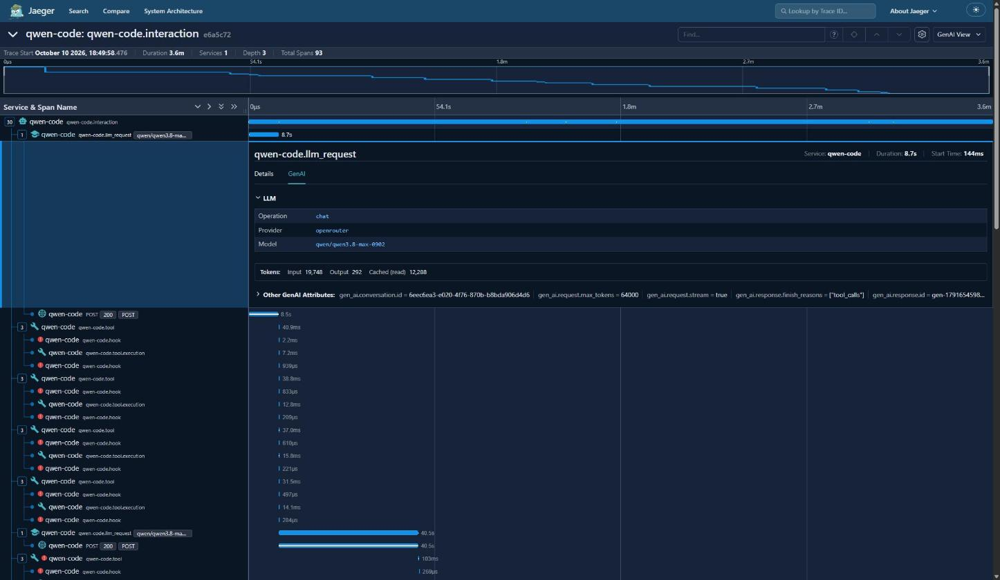
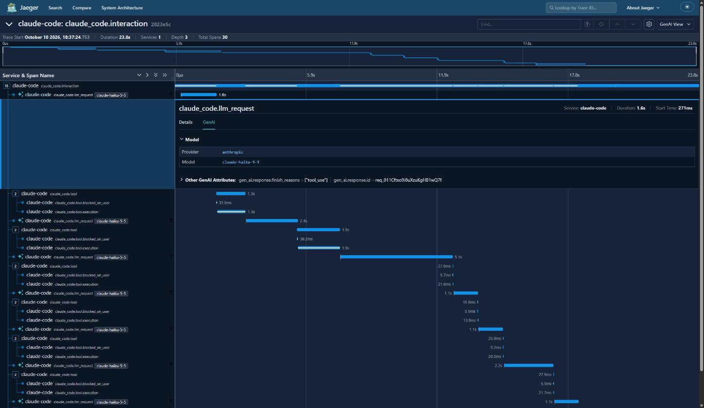
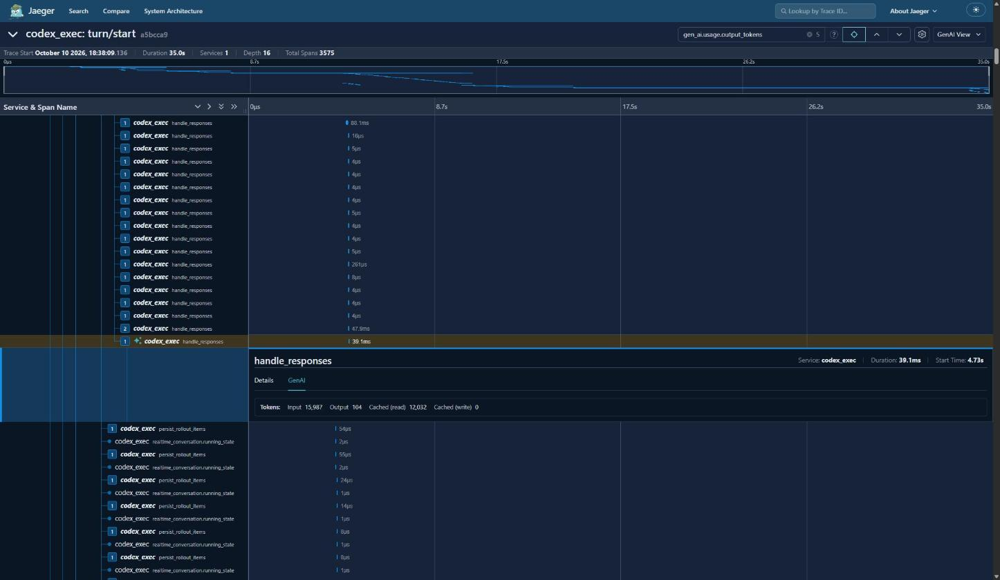
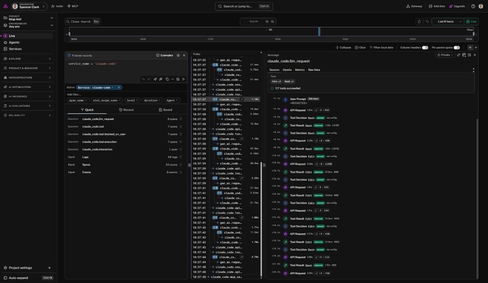
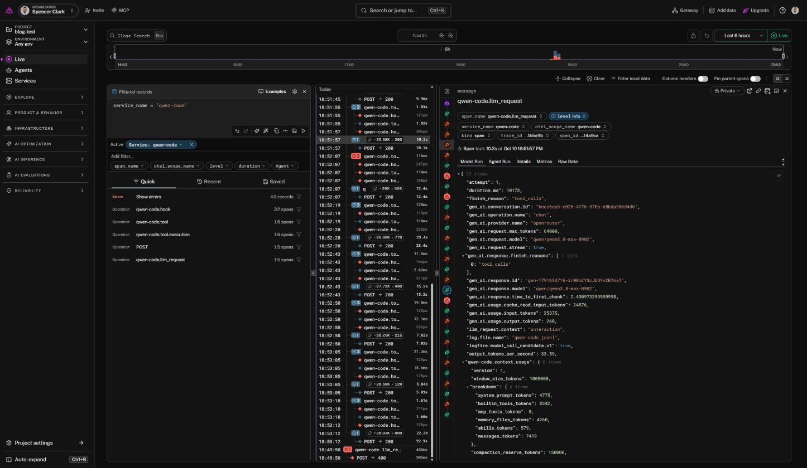
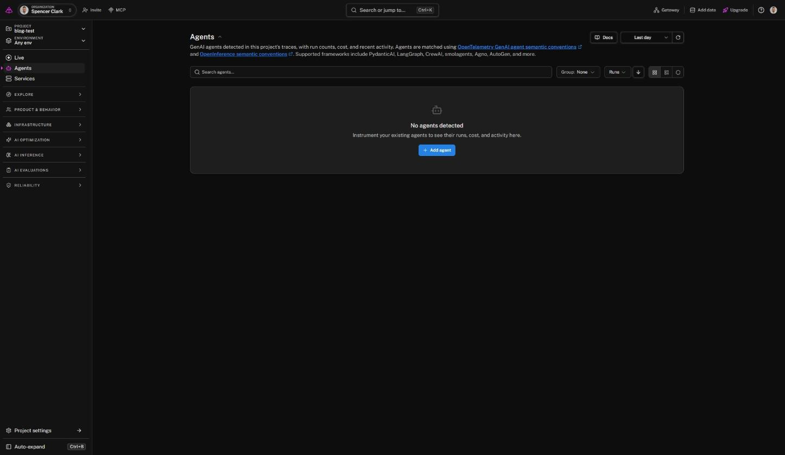
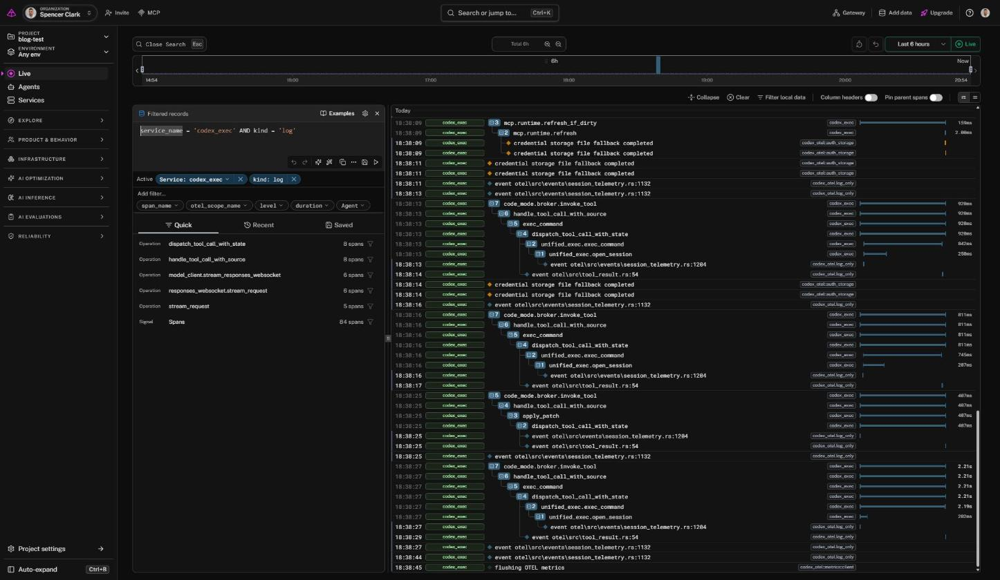

# Where it lands: what Jaeger, Logfire, LangSmith, Langfuse and Braintrust do with coding-agent telemetry

*Part 2 of 2. [Part 1](part-1-one-standard-three-dialects.md) covered what Claude Code,
Codex and Qwen Code send over OpenTelemetry.*

Part 1 ended with three agents, one standard and three dialects:

- **Claude Code** sends tidy product analytics in its own attribute names.
- **Codex** sends thousands of internal spans, with its token counts on the wrong span.
- **Qwen Code** follows the GenAI semantic conventions, and logs your prompts by default.

Here I send that same data to backends and look at what comes out the other side.

Two things decide what you see. The first is **attribute names**, because a backend can
only build an LLM view from names it recognises. The second is **signals**. Some backends
accept only traces, and a lot of what these agents say goes into logs and metrics. And for
Claude Code and Codex, most of these vendors' own recommended integrations skip
OpenTelemetry entirely.

Everything is reproducible from the kit at
[github.com/spenceclark/code-agent-otel](https://github.com/spenceclark/code-agent-otel).
I checked the vendor details against each vendor's own docs on 10 October 2026, and
tested only Logfire end to end.

## The local baseline: Jaeger's GenAI tab

Part 1 used Jaeger (2.22) as a neutral trace viewer. It also has a **GenAI** tab in each
span's detail panel, plus icons that mark LLM, tool and HTTP spans in the span list. It's
the simplest test of "does this backend understand GenAI attributes?", and the three
agents get very different results.

**Qwen Code** fills it completely: operation `chat`, provider, model, and input, output
and cached tokens. Tool spans get a tool icon and a "Tool Call: read_file" label.



**Claude Code** gets provider and model only. Jaeger reads the provider from Claude's
deprecated `gen_ai.system` attribute. There are **no tokens**, because Claude calls them
`input_tokens`, not `gen_ai.usage.input_tokens`, and there's no operation name. Its tool
spans aren't recognised at all.



**Codex** gets tokens only, and only on the right span if you can find it. The tokens sit
on a 39 ms `handle_responses` span, surrounded by dozens of 4 µs spans with the same name.
There's no model or provider. Jaeger's Find box (`gen_ai.usage.output_tokens`) is the only
practical way to locate it.



The viewer and the task were the same for all three, yet one agent gets a full LLM view,
one a partial one, and one almost nothing. The difference is in the attribute names.

## How hosted backends ingest OpenTelemetry

All four hosted backends work the same way on the way in. You add an `otlphttp` exporter to
a collector (or point the agent at the backend directly) with:

1. **An endpoint**, usually one per region.
2. **An auth header**, sometimes with a routing header for the project or workspace.
3. **The signals you wire up.** This is where they differ most.

On the server side, a mapping layer looks for conventions it recognises:

- the vendor's own namespace (`langsmith.*`, `langfuse.*`, `braintrust.*`);
- the GenAI conventions (`gen_ai.*`);
- OpenInference (`openinference.span.kind`, `llm.*`);
- OpenLLMetry (`traceloop.*`).

Spans that match become LLM-aware objects (a "generation", an LLM "run", an `llm` or
`tool` span) with model, tokens, cost and messages attached. Anything else becomes a plain
span, with its attributes kept as metadata.

| | LangSmith | Langfuse | Braintrust | Logfire |
|---|---|---|---|---|
| **Traces** | yes | yes | yes | yes |
| **Logs** | not documented | **no** (`/v1/logs` returns 404) | yes | yes |
| **Metrics** | not documented | accepted, then **dropped**¹ | not documented | yes |
| Auth | `x-api-key` (+ project header) | Basic auth with a key pair, plus an ingestion-version header | Bearer key + `x-bt-parent` project header | Write token in `Authorization` |
| `gen_ai.operation.name` | `chat` → LLM run | `chat`, `execute_tool`, `invoke_agent` all mapped¹ | `chat` → LLM, `execute_tool` → tool | drives its LLM and Agents views |
| Special handling | | | **maps Claude Code's span names** | **a Claude Code session panel** (undocumented; see below) |
| Limit that matters here | 25,000 runs per trace | 5 MB per request | 10 MB per trace upload | **drops records older than 24 h** |
| Self-host | Enterprise | **MIT open source** | Enterprise | Enterprise |
| Free tier | 5k traces/month | 50k units/month, and every span is a unit | 1 GB/month | 10M records/month |

¹ From Langfuse's source code, where the docs were silent.

Langfuse bills every span as a unit, so a single ~4,700-span Codex run uses almost a tenth
of the free tier.

## Signals decide what you lose, and what leaks

Several things from Part 1 exist only in logs or metrics:

| Data | Lives in | LangSmith | Langfuse | Braintrust | Logfire |
|---|---|---|---|---|---|
| Claude Code's cost (`claude_code.cost.usage`) | metrics | no | no | no | yes |
| Claude Code's per-request detail (`api_request`, `tool_result`, ...) | logs | no | no | yes | yes |
| Codex's tool output, including file contents | logs | no | no | yes | yes |
| Qwen Code's prompts (default `logPrompts=true`) | logs | no | no | yes | yes |
| Qwen Code's `chat` / `execute_tool` / `invoke_agent` spans | traces | partly | yes | partly | yes |

This cuts both ways:

- **With a traces-only backend, the privacy problems from Part 1 mostly stay home.**
  Qwen's prompt logging and Codex's tool-output logging never leave your collector,
  because nothing downstream accepts logs.
- **You also lose Claude Code's cost and most of its per-call detail.** Qwen Code is the
  agent that loses least, because it put its best information on spans with standard
  names.
- **Send logs to Braintrust or Logfire and all of it arrives,** good and bad.

So choosing a backend is partly a privacy decision, whether or not you meant it to be.

## Most vendors' coding-agent integrations skip OTel

Here's the route each vendor's docs recommend for these agents:

| | Claude Code | Codex CLI |
|---|---|---|
| LangSmith | hooks plugin (reads transcripts) | hooks plugin (reads transcripts) |
| Langfuse | Stop hook (reads transcripts) | Stop hook (reads transcripts) |
| Braintrust | hooks plugin **or native OTel** | hooks plugin (rebuilds spans from the transcript) |
| Logfire | no page | **native OTel** or a hooks plugin |

None of the four documents Qwen Code. LangSmith's and Langfuse's only documented
native-OTel coding agent is GitHub Copilot.

The default is hooks that read the session transcript after each turn. Native OTel is a
second option for one agent each at two of the vendors. A transcript has two advantages.
It holds the whole conversation, which the OTel defaults redact, and it doesn't depend on
how each vendor chose to name its spans.

## Worked example: replaying the captures to Logfire

I picked Logfire to test end to end. It accepts all three signals, it says it's "built on
OpenTelemetry", and it has a SQL API I could use to check exactly what arrived.

### Replay instead of re-run

You don't need to re-run the agents to try a backend. The captures from Part 1 are already
OTLP (each JSONL line is one export request), and the collector can read them back in. So
the kit has a one-shot "replay" collector:

```
captures/runs/<run>/{traces,logs,metrics}/*.jsonl
  -> otlp_json_file receiver (one per signal)
  -> transform: delete identity attributes everywhere
  -> resource: tag kit.replay=true
  -> debug exporter (counts)  [+ otlp_http exporter to the backend]
```

The core of it:

```yaml
receivers:
  otlp_json_file/traces:
    include: [/replay/traces/*.jsonl]
    start_at: beginning
    max_log_size: 16MiB          # one line is one export request; Codex lines reach ~0.5 MB
  # ...same for metrics and logs

processors:
  transform/strip_identity:
    error_mode: ignore
    trace_statements:
      - context: resource
        statements: ['delete_matching_keys(attributes, "^(user\\..*|organization\\.id|host\\.name)$")']
      - context: span
        statements: ['delete_matching_keys(attributes, "^(user\\..*|organization\\.id|host\\.name)$")']
      - context: spanevent
        statements: ['delete_matching_keys(attributes, "^(user\\..*|organization\\.id|host\\.name)$")']
    # ...the same for log and datapoint attributes
```

Run on its own it's a dry run. A vendor overlay adds the exporter:

```yaml
exporters:
  otlp_http/logfire:
    endpoint: ${env:LOGFIRE_ENDPOINT}     # https://logfire-eu.pydantic.dev (or -us)
    headers:
      Authorization: ${env:LOGFIRE_TOKEN} # a project write token, no "Bearer"
    sending_queue:
      enabled: false                      # export synchronously so failures show up
service:
  pipelines:
    traces:  { exporters: [debug, otlp_http/logfire] }
    metrics: { exporters: [debug, otlp_http/logfire] }
    logs:    { exporters: [debug, otlp_http/logfire] }
```

Before sending anything, I checked what was left after deleting the identity keys. The
stripped Codex data still named my MCP servers and an internal API hostname. Qwen's logs still held my username in file paths, plus the contents of its memory
notes. So I sent Claude Code and Codex with all signals, and Qwen Code without its logs:

```bash
scripts/replay.sh captures/runs/claude-default-... logfire
scripts/replay.sh captures/runs/codex-default-... logfire
KIT_REPLAY_SKIP=logs scripts/replay.sh captures/runs/qwen-default-... logfire
```

### Did it all arrive?

The query API takes SQL over Logfire's `records` and `metrics` tables, authenticated with a
read token:

```bash
curl -X POST https://logfire-eu.pydantic.dev/v2/query \
  -H "Authorization: Bearer $LOGFIRE_READ_TOKEN" -H 'Content-Type: application/json' \
  -d '{"sql": "SELECT service_name, kind, count(*) FROM records GROUP BY 1, 2",
       "min_timestamp": "2026-10-10T00:00:00Z"}'
```

Everything arrived:

- **Every span, log record and metric datapoint**, with counts matching what was sent:
  30 spans, 49 logs and 40 datapoints from Claude Code; 4,710 spans, 48 logs and 222
  datapoints from Codex; and 95 spans and 776 datapoints from Qwen Code.
- **No ingest errors and no identity keys.**
- **Claude Code's cost metric survived intact** at $0.00799, matching the CLI's own figure.
  Logfire is the only one of the four that documents accepting metrics, so it's the only
  one I'd expect to hold that number.

### What Logfire showed

I expected Qwen Code to come out best, as it did in Jaeger, and I counted spans with the
`gen_ai.*` fields that Logfire's docs say its LLM views read. Then I opened the UI.

**Claude Code gets its own panel.** Click a `claude_code.llm_request` span and the first
tab is **Session**: a timeline built from Claude's *log* events. It shows:

- the prompt (redacted, with its length);
- each API request with its duration and tokens;
- each tool decision ("accept, via config");
- each tool result with duration and size;
- a summary line ("Edit ×4, Bash ×3, 7/7 tools succeeded").

Claude's log records carry trace context, so Logfire also nests them inside the trace.



So in Logfire, Claude Code's per-call tokens are visible after all. They come from its logs
rather than from `gen_ai.usage.*` on spans, through a Claude Code-specific integration that
isn't in Logfire's docs. It also means the backend that accepts logs is the one that can
show this, and a traces-only backend never could.

**Qwen Code gets the generic GenAI treatment.** LLM spans carry token badges, and the
interaction row rolls up the whole trace (↑348.3K ↓7,233 tokens). Spans open on **Model
Run** and **Agent Run** tabs. Logfire stamps them at ingest as model-call and agent-run
candidates. In default-privacy mode there are no messages to render, so those tabs show the
`gen_ai.*` attributes. Qwen also reports a per-call context-window breakdown (system prompt,
built-in tools, memory files, messages), which neither of the others sends.



**The Agents view stayed empty.** Over both 6 and 24 hours it said "No agents detected".
That's despite Qwen's span carrying `gen_ai.operation.name=invoke_agent`,
`gen_ai.agent.name`, a conversation ID, and Logfire's own agent-run-candidate flag. The
docs don't say why. One guess is that the conventions name that span `invoke_agent
{agent name}`, and Qwen calls it `qwen-code.interaction`, but I haven't tested that.



**Codex gets nothing LLM-specific.**

- Its `persist_rollout_items` and `realtime_conversation.running_state` spans flood the
  Live view.
- Its log records show up labelled by Rust source location, such as
  `event otel\src\tool_result.rs:54`. That's because Codex puts the source location in
  OTLP's standard event-name field, and its documented name (`codex.tool_result`) in an
  `event.name` attribute instead. Logfire displays the standard field.
- The per-call LLM data does exist, in `response.completed` log events carrying the model,
  token counts and time to first token. But they open only on a generic attributes tab.



### Gotchas from the replay

- **Logfire drops records more than 24 hours old,** going by the record's own timestamp.
  The replay keeps the original timestamps, so you have a day from capture to send.
- **The auth header format is inconsistent in the docs.** Some pages use the raw write
  token, others prefix it with `Bearer`. The raw token worked for ingest, and the query
  API wants `Bearer` with a read token.
- **The collector's own log sampling will lie to you.** I counted items by reading the
  debug exporter's log lines, and some batches seemed to go missing. They hadn't. The
  collector samples repeated log messages by default (the first 10, then 1 in 100). Turn
  that off (`service.telemetry.logs.sampling.enabled: false`) before trusting any count
  you read from logs.
- **The `otlpjsonfile` receiver is now `otlp_json_file`.** It also tails files forever,
  so a replay needs a timeout.
- **Metric temporality:** Logfire's standard dashboards want delta temporality. The kit
  exports cumulative for Prometheus, so those metrics are queryable but don't fill the
  dashboards without a `cumulativetodelta` processor.

## Choosing a backend for coding-agent telemetry

From this sample of three agents and four backends:

- **If you want everything, including cost and Claude Code's per-request detail,** you
  need a backend that takes logs and metrics. Logfire is the only one of the four
  documented to accept all three signals, and it showed the most.
- **If you'd rather prompts and tool output never leave the building,** a traces-only
  backend does that by default. Know what you're giving up, and scrub values in the
  collector anyway.
- **If you need to self-host on open source,** Langfuse is the only option of the four.
  It's traces-only.
- **Qwen Code works reasonably everywhere,** because it speaks the standard.
- **Claude Code works best where someone special-cased it:** Braintrust's span-name
  mapping, and Logfire's session panel.
- **Codex works best through the vendors' hook-based plugins,** not its own OTel.

## The standard is only as good as the names

All three agents speak OpenTelemetry, and all five backends accept it. How useful the
result is depends on whether everyone uses the same names, and mostly they don't yet.

If you build an agent, the most valuable thing you can do for your users' observability
is the boring one. Use the `gen_ai.*` names and put them on the right spans. If you build
a backend, document what you special-case. I only found Logfire's Claude Code panel by
clicking on it.
